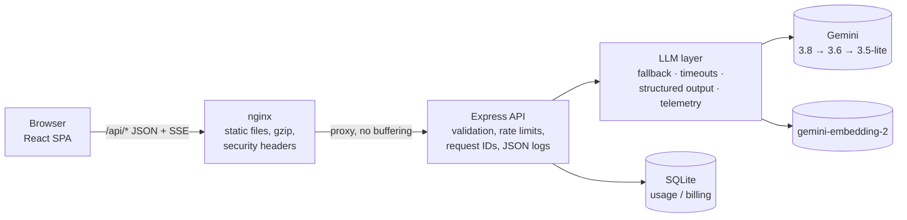

# ResumeTailorAI

> Tailor a resume to a specific job with Google Gemini: match scoring, keyword gaps, a streamed rewrite, cover letter, interview prep and multi-job comparison. Built as a production-grade reference for shipping LLM features: streaming with cancellation, model fallback, structured output, and per-request telemetry you can inspect in the UI.

[](https://github.com/Nadeeja99/ResumeTailorAI/actions/workflows/ci.yml)
   

## Contents

- [What it does](#what-it-does)
- [Architecture](#architecture)
- [Quick start](#quick-start)
- [Configuration](#configuration)
- [AI engineering notes](#ai-engineering-notes)
- [API](#api)
- [Frontend](#frontend)
- [Security and deployment](#security-and-deployment)
- [Testing and CI](#testing-and-ci)
- [Troubleshooting](#troubleshooting)
- [Known limitations](#known-limitations)

## What it does

| Tool | What you get |
|---|---|
| **Optimizer** | Match score, missing keywords, strengths, tone and ATS scores; then a streamed, Markdown-formatted rewrite with a word-level diff and PDF / Word export |
| **Semantic match** | Embedding-based section scores and requirement coverage, with a **chunk inspector** showing the exact resume line behind each verdict |
| **Interview prep** | 8 role- and candidate-specific questions with ideal answers (Markdown, code blocks where useful) and coaching tips |
| **Cover letter** | Streamed, tailored letter with copy / PDF / Word export |
| **Compare jobs** | Score one resume against up to 5 job descriptions, best fit first |

Inputs can be pasted, uploaded (.txt, .pdf, .docx) or imported from a LinkedIn PDF export. Every AI output has an expandable **System telemetry** panel: model and fallback chain, time to first token (server and browser), token usage including thinking tokens, schema-validation status, context sizes and — in development — the raw system and user prompts.

## Architecture



```
frontend/                 React 18 · Vite 8 · Tailwind 3 · shadcn/ui (Radix)
  src/services/           aiClient.ts (fetch + SSE v2 + timing), resumeApi.ts (typed endpoints)
  src/hooks/useAI.ts      useAITask / useAIStream — cancellation, status machine, telemetry
  src/components/ai/      TelemetryDrawer, StreamControls, Markdown renderer, CodeBlock
  src/components/…        tools, inputs, optimizer, semantic (chunk inspector), layout, theme
  e2e/                    Playwright smoke suite (mocked API)
  nginx.conf, nginx/      production server config + security headers
backend/                  Node · Express · TypeScript (strict) · @google/genai
  src/services/llm/       client (fallback, timeouts, thinking), structured, text (streaming), telemetry, errors
  src/services/semantic/  chunking, calibration, lexical (hybrid matching)
  src/prompts/            versioned prompts (v2: system/user split, injection guard)
  src/lib/                aiRoute (JSON + SSE route wrappers), sse, logger
  src/config/env.ts       validated environment
```

The Gemini key lives only in `backend/.env`; the browser never sees it.

## Quick start

**Prerequisites:** Node **22.12+** (24 recommended — see `.nvmrc`), npm, and a [Gemini API key](https://aistudio.google.com/).

```bash
npm run install:all                     # installs frontend/ and backend/
cp backend/.env.example backend/.env    # then set GEMINI_API_KEY
npm run dev                             # frontend :8080 + backend :3001
```

Open http://localhost:8080. Without a key the UI still works, and analysis falls back to a local keyword heuristic.

### Docker

```bash
GEMINI_API_KEY=your-key docker compose up --build    # or put it in a root .env
```

Serves on http://localhost:8080. nginx proxies `/api` to the backend (which waits until its health check passes); SQLite lives on the `app-data` volume.

## Configuration

All backend settings are validated at startup (`backend/src/config/env.ts`); invalid values fail fast with a clear message, and production refuses to start without `GEMINI_API_KEY`.

| Variable | Default | Purpose |
|---|---|---|
| `GEMINI_API_KEY` | — | Required in production |
| `GEMINI_MODELS` | `gemini-3.8-flash,gemini-3.6-flash,gemini-3.5-flash-lite` | Fallback chain, tried in order |
| `EMBEDDING_MODEL` | `gemini-embedding-2` | Semantic analysis |
| `LLM_TIMEOUT_MS` | `90000` | Per model attempt (request/response) |
| `LLM_FIRST_TOKEN_TIMEOUT_MS` | `45000` | Streams: abandon a silent model and fall back |
| `LLM_STREAM_TIMEOUT_MS` | `300000` | Streams: cap on a whole generation |
| `LLM_THINKING_LEVEL` | per operation (`LOW`) | Global override: `MINIMAL` · `LOW` · `MEDIUM` · `HIGH` |
| `EXPOSE_PROMPTS` | `true` outside production | Include raw prompts in telemetry (they contain resumes) |
| `CORS_ORIGINS` | `http://localhost:8080,http://localhost:5173` | Allowed browser origins |
| `TRUST_PROXY` | `0` (`1` in compose) | Proxy hops to trust for client IPs / rate limits |
| `LOG_LEVEL` | `info` (`silent` in tests) | JSON log level |
| `DATABASE_PATH` | `data/app.db` | SQLite file |
| `STRIPE_*` | — | Optional billing (see `backend/.env.example`) |

## AI engineering notes

**Model fallback.** Each call walks `GEMINI_MODELS`. It moves on for errors another model might not hit — 404, 429, 5xx **and timeouts** (overloaded models often hang rather than return 503) — but surfaces auth and bad-request errors immediately, since they would fail identically everywhere. The attempt chain is recorded in telemetry.

**Streaming timeouts.** The SDK's timeout covers the whole response body, which would cut off long generations. Streams instead get a *first-token* deadline inside the fallback loop: a queued model is abandoned for the next one while nothing has been shown yet; once text flows only the total cap applies. In live testing this turned a hard failure into a 1.6 s answer from the second model.

**Thinking levels (measured).** `gemini-3.8-flash` rejects `MINIMAL` with a 400, so only `LOW` (accepted by every configured model) is used. On analysis, `LOW` cut thinking tokens from 827 to 0 with equivalent output. If a model still rejects a level, the call retries once with the model default.

**Structured output.** JSON endpoints send a Zod-derived JSON Schema as Gemini's `responseJsonSchema`, validate the reply with the same schema, and make one repair call with the validation errors if needed. Telemetry reports `valid`, `repaired` or `failed`.

**Prompts v2.** Each prompt is a system instruction plus user content. Documents are wrapped in XML tags, declared as data rather than instructions, and closing tags inside a document are escaped so it cannot break out of its block. The prompt version is reported with every response.

**Semantic matching.** Requirements are embedded and matched against individual resume lines (whole sections dilute similarity). Raw cosine is mapped to 0–100 with a per-model calibration (for `gemini-embedding-2`, matches scored 0.70–0.82 and non-matches 0.59–0.67). Coverage is **hybrid**: semantically close *and* a distinctive requirement term present in the resume — dense skill lists otherwise "match" every technology (Docker scored 0.70 against "React, TypeScript, Node.js, AWS"). A cosine ≥ 0.80 counts on its own so genuine synonyms survive. All of this is visible in the chunk inspector.

**Cancellation.** Stopping in the UI (button or Esc) aborts the fetch; the server sees the disconnect and aborts the Gemini request, so abandoned generations stop costing tokens.

## API

All AI endpoints accept JSON and validate input with Zod (resume 50–15,000 chars, job description 20–10,000).

| Method | Path | Response |
|---|---|---|
| `POST` | `/api/analyze` | JSON |
| `POST` | `/api/compare-jobs` | JSON |
| `POST` | `/api/semantic-analysis` | JSON |
| `POST` | `/api/interview-prep` | JSON |
| `POST` | `/api/parse-linkedin` | JSON |
| `POST` | `/api/generate-improved` | SSE |
| `POST` | `/api/generate-cover-letter` | SSE |
| `GET` | `/api/health` | Liveness/readiness (DB check, AI configuration) |
| — | `/api/billing/*` | Stripe checkout, portal, status, webhook |

**JSON envelope:** `{ "data": …, "telemetry": {…} }` on success; `{ "error", "code", "telemetry" }` on failure. Codes include `QUOTA`, `UNAVAILABLE`, `TIMEOUT`, `INVALID_OUTPUT`, `BLOCKED`, `AUTH`, `RATE_LIMITED`.

**SSE v2:** every frame is `data: <json>`; `: ping` comments arrive every 15 s.

```
{"type":"meta","requestId":"…","operation":"generate-improved","promptVersion":"v2"}
{"type":"chunk","text":"…"}                               // repeated
{"type":"done","telemetry":{…}}                            // or
{"type":"error","error":"…","code":"TIMEOUT","telemetry":{…}}
```

Every response carries an `X-Request-Id` header that matches the backend's JSON logs and the telemetry panel.

## Frontend

- **Design system:** zinc neutrals with a single blue accent, 1px borders, self-hosted Inter; light, dark and system themes with the choice persisted and applied before first paint (no flash).
- **Request layer:** `useAITask` / `useAIStream` give every call the same states (idle, loading, streaming, success, error, aborted), cancel superseded or unmounted requests, batch streamed chunks per animation frame, and keep partial text when stopped. Errors stay inline with a Retry button and their telemetry.
- **Resilience:** an error boundary per tool and at the root; the offline heuristic is used only when the AI is unreachable (network or 5xx), never to mask validation or rate-limit errors.
- **Input UX:** ⌘/Ctrl+Enter to submit, Esc to stop streaming, autofocus, live character counts with the backend's exact limits.
- **Performance:** about 125 kB gzipped of JS on first load, split into `react` and `ui` vendor chunks (long-cached) and a ~22 kB app chunk. PDF/DOCX parsing and export, Markdown + Prism, the diff view and the four secondary tools load on demand (tools prefetch on tab hover).

## Security and deployment

- **Backend:** helmet, CORS allow-list, per-IP rate limits (AI routes 10/min), 2 MB body limit, request IDs, structured JSON logs, graceful shutdown on SIGTERM, Docker `HEALTHCHECK`, non-root container.
- **nginx:** gzip (never on SSE), immutable caching for hashed assets, `no-cache` for `index.html`, and security headers from `frontend/nginx/security-headers.conf`: a strict CSP (no inline or eval scripts; `frame-ancestors 'none'`), nosniff, Referrer-Policy, Permissions-Policy, COOP. Enable the commented HSTS line once served over HTTPS.
- **CSP hash:** the small inline script in `index.html` that applies the theme before paint is allowed by its SHA-256 hash. If you edit it, update the hash in `security-headers.conf` — `src/test/nginx.test.ts` fails until you do. `vite preview` serves the same headers, so the Playwright suite runs under the production CSP.
- **Dependencies:** `npm audit` is clean in both packages; Dependabot proposes weekly updates.

## Testing and CI

```bash
npm run verify             # lint + typecheck + unit tests + build (both packages)
npm run test:e2e --prefix frontend   # Playwright: desktop-light and mobile-dark
```

| Suite | Covers |
|---|---|
| Backend (Vitest + Supertest) | Routes, SSE event order, client-disconnect abort, model fallback, timeouts, thinking retry, schema repair, prompt injection guard, semantic chunking / calibration / hybrid matching, env validation, health and HTTP hardening |
| Frontend (Vitest + Testing Library) | API client and SSE parser, hooks (abort, supersede, unmount), Optimizer flows, Markdown safety, telemetry drawer, stream controls, theme and pre-paint script, file parsing, CSP/nginx config |
| E2E (Playwright, API mocked in-browser) | Full tailor flow with streaming and exports, cancel/stop, heuristic fallback, rate-limit errors, pricing dialog, PDF upload through pdf.js, headers, theme persistence, layout overflow, lazy tools, 404 — each test also fails on any CSP violation or page error |

GitHub Actions (`.github/workflows/ci.yml`) runs the verify, e2e and Docker jobs on every push and pull request; the Docker job builds both images, starts the stack and checks health, headers, caching and the API proxy through nginx. No job calls Gemini.

## Troubleshooting

- **`npm install` fails with "Cannot read properties of null (reading 'edgesOut')"** — a resolver bug in npm 11.4.x with this dependency tree. Use a newer npm: `npx npm@11.21.0 install`.
- **Install scripts:** newer npm versions only run approved install scripts. The approvals live in each `package.json` under `allowScripts` (`better-sqlite3`, `esbuild`, `@swc/core`) and are pinned to exact versions — re-approve with `npx npm@11.21.0 install-scripts approve <pkg>` after upgrading them, or native binaries may be missing.
- **`overrides` in `frontend/package.json`** pins `postcss-selector-parser` to a patched version under Tailwind 3 (verified to produce byte-identical CSS). Remove it when migrating to Tailwind 4.
- **AI requests are slow or time out** — check the telemetry panel's fallback chain; overloaded models time out and the next one is used automatically.

## Known limitations

- **Billing is not enforced.** The Stripe routes and a `usageLimit` middleware exist, but the middleware is not mounted, and the anonymous user ID is generated in the browser, so limits would be easy to bypass. Treat billing as a scaffold.
- No user accounts or server-side storage of resumes; everything lives in the browser session.
- HSTS is off until the deployment serves HTTPS.
